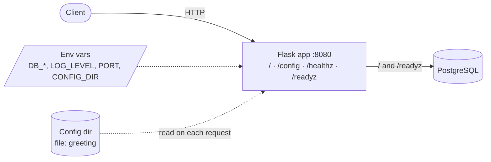

# demo-app

A tiny Flask app that shows health checks, configuration via environment
variables, database credentials from env vars, and config files read from a
directory.

## Architecture



## Endpoints

| Path       | Purpose                                          | Touches DB |
|------------|--------------------------------------------------|------------|
| `/healthz` | Liveness check – returns `200 {"status":"ok"}`   | no         |
| `/readyz`  | Readiness check – `200` if DB reachable, else `503` | yes     |
| `/`        | Returns a greeting and the PostgreSQL version. The greeting is the content of the file `greeting` in the config dir (default: `Hello from Kubernetes!`) | yes |
| `/config`  | Lists every file found in the config dir with its content | no |

## Configuration (environment variables)

| Variable      | Required | Default | Description                                   |
|---------------|----------|---------|-----------------------------------------------|
| `LOG_LEVEL`   | no       | `INFO`  | `DEBUG`, `INFO`, `WARNING`, `ERROR`, `CRITICAL` |
| `PORT`        | no       | `8080`  | HTTP listen port                              |
| `CONFIG_DIR`  | no       | `/etc/demo-app` | Directory the config files are read from |
| `DB_HOST`     | yes      |         | PostgreSQL host                               |
| `DB_PORT`     | no       | `5432`  | PostgreSQL port                               |
| `DB_NAME`     | yes      |         | Database name                                 |
| `DB_USER`     | yes      |         | Database user                                 |
| `DB_PASSWORD` | yes      |         | Database password                             |

## Test it

```bash
curl localhost:8080/healthz            # {"status":"ok"}
curl localhost:8080/                   # greeting + PostgreSQL version
curl localhost:8080/config             # files from the config dir
```

## Notes

- Liveness deliberately does not check the DB, so a DB outage doesn't cause restart loops.
